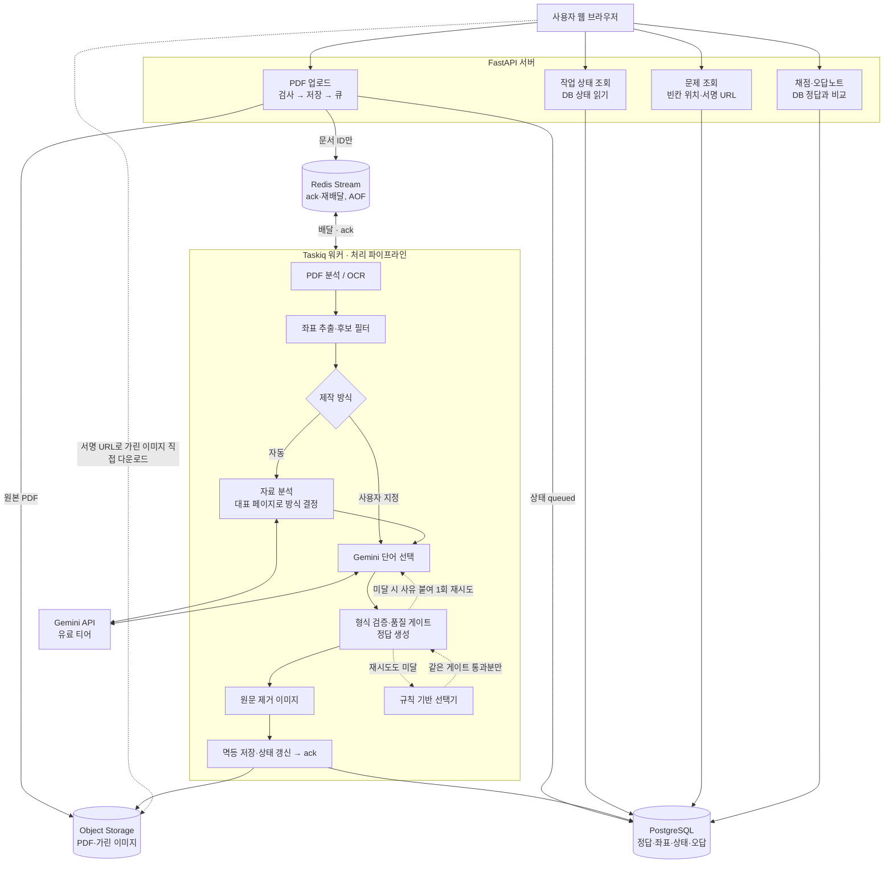

# 아키텍처 정의서 — PDF 빈칸 학습 서비스

- 작성일: 2026-10-27
- 수정: 2026-10-27 제작 방식 선택·자료 분석·품질 게이트 추가, 출처를 공식 문서로 교체. 같은 날 결정은 ADR로, 세부는 상세 설계서로 분리
- 상태: **아키텍처 확정(구현 전).** 코드는 아직 없다.
- 관계: `DESIGN.md`(2026-10-02)의 후속 문서. DESIGN.md가 "무엇을, 왜"를 다룬다면 이 문서는 "어떤 부품으로, 어떻게 연결하는가"를 다룬다. 두 문서가 충돌하면 이 문서가 우선한다.
- 결정의 배경·검토한 선택지는 [아키텍처 결정 기록(ADR)](decisions/)에 결정마다 한 파일로 둔다. 이 문서의 결정 표는 요약이다.
- 표기: **[확인]** = 출처로 확인함. **[미확인]** = 구현 전에 확인 필요. **[권장]** = 제안했으나 팀 확정 전.

---

## 1. 한눈에 보기

핵심 구조는 **코드베이스 하나, 프로세스 둘(API + 워커)인 모듈러 모놀리스**다. API는 요청을 빠르게 받고 돌려주는 일만 하고, 수 초~수 분 걸리는 PDF 처리는 전부 워커가 한다.

---

## 2. 확정된 결정

| 항목 | 결정 | 이유 |
|---|---|---|
| 프로세스 구성 | API 서버와 워커를 같은 패키지에서 프로세스만 분리 | PDF 파서 격리(DESIGN D3), 긴 작업이 API를 막지 않게(C22). 이 규모에서 마이크로서비스는 불필요 |
| 작업 큐 | **Taskiq + taskiq-redis `RedisStreamBroker`** | asyncio 기반, ack로 워커가 죽어도 작업이 남음. arq는 유지보수 전용이라 제외 → [ADR-001](decisions/ADR-001-task-queue-taskiq.md) |
| 작업 상태의 기준 | **PostgreSQL** | Redis가 재시작돼도 진행 상태·부분 성공 정보가 남아야 함. Redis는 전달만 담당 |
| 결과 백엔드 | `RedisAsyncResultBackend`는 디버깅용 보조로만, 만료 시간 설정 | 상태 조회 API는 여기를 읽지 않음 |
| 원본 PDF 경로 | 업로드 API가 검사 후 Object Storage에 저장, 큐에는 문서 ID만 | 큐 메시지에 파일을 싣지 않음 |
| 실패 처리 | 검증 실패 → 오류 붙여 1회 재시도 → 규칙 기반 선택기로 폴백 | Gemini 장애에도 서비스가 멈추지 않음(C9, C10) |
| 제작 방식 선택 | 업로드할 때 함께 고른다. 자동(기본)과 프리셋 4종(어휘 문맥, 개념 용어, 수치·날짜, 정의) | 작업 하나·상태 한 벌 구조 유지 → [ADR-004](decisions/ADR-004-preset-at-upload.md) |
| 자료 분석 | "자동"일 때만 파이프라인 안에서 Gemini 1회로 자료 유형을 판단해 방식을 정한다. 분석할 페이지는 시스템이 고른다(5.3) | 사용자는 문서 전체를 올리기만 하면 되고, 페이지를 고르는 부담을 지지 않는다 |
| 품질 게이트 | 형식 검증 뒤에 결정적 코드로 품질의 바닥을 검사한다(5.3). LLM 판정은 바닥에 쓰지 않는다 | 형식만 맞고 쓸모없는 빈칸을 막는다. 실패할 수 있는 검사기에 기대면 바닥이 보장되지 않는다 |
| 흐름 제어 도구 | LangGraph 같은 에이전트 프레임워크는 쓰지 않는다 | 다음 단계를 코드가 정하는 고정 파이프라인 → [ADR-005](decisions/ADR-005-no-agent-framework.md) |
| 후보 필터 | 좌표 추출과 Gemini 호출 사이 | 불용어·머리글/바닥글·저신뢰 OCR 단어 사전 제거(C7) |
| 이미지 전달 | 짧게 만료되는 서명 URL, 가린 이미지만 발급 | API 부하 감소, 원본 이미지 노출 차단(D4) |
| 리댁션 방식 | 렌더링한 이미지에 사각형을 칠하는 래스터 채우기로 통일 | 텍스트 PDF와 스캔본이 같은 경로 → [ADR-003](decisions/ADR-003-raster-redaction.md) |
| PDF 라이브러리 | **pypdfium2(렌더링) + pdfplumber(단어·글자 좌표)** | 라이선스 부담 없음 → [ADR-002](decisions/ADR-002-pdf-library-pdfplumber.md) |
| Gemini 요금제 | 개발 중 무료 티어, 다른 사람 자료를 받기 전에 유료 전환 | 무료 티어 입력은 Google 제품 개선에 쓰이고 사람이 검토할 수 있음 [확인] |
| 배포 | VPS + Docker Compose | 소규모(수십 명 이하)에 가장 단순하고 저렴 |
| 개발 환경 | 파이썬 버전과 라이브러리 버전을 팀 전체가 통일 | 10/27 팀 미팅 결정. 구체 버전은 레포 생성 시 고정 |

### 2.1 권장안 (팀 확정 필요)

| DESIGN.md 항목 | 권장 | 비고 |
|---|---|---|
| 10.1 규모 | (b) 지인·소규모 | 배포 구성(VPS)이 이 전제를 따름 |
| 10.3 인증·비용 | Google 로그인 + 운영자 부담 + 사용자별 일일 한도 | 계정이 있어야 사용자별 캐시·한도·삭제 요청이 성립. BYOK는 후속 옵션 |
| 10.4 자료 성격 | (a) 본인이 올린 자료를 본인만 열람 | 공유 기능은 v2. 접근 제어가 "업로더 본인" 한 줄 규칙으로 끝남 |

---

## 3. 구성 요소

### 3.1 FastAPI 서버
| API | 하는 일 | 읽고 쓰는 곳 |
|---|---|---|
| `POST /documents` | PDF와 제작 방식(`preset`, 기본 `auto`)을 받는다. 크기·MIME 시그니처 검사, 암호화·JS 포함 PDF 거부, 원본을 스토리지에 저장, 상태 `queued` 기록, 작업 등록 | Storage(쓰기), Postgres(쓰기), Redis(작업 등록) |
| `GET /jobs/{id}` | 진행 상태 반환(폴링) | Postgres(읽기) |
| `GET /blank-sets/{id}` | 빈칸 목록(`blank_id`, bbox, type, hint), 가린 이미지의 서명 URL, 적용된 제작 방식과 그 이유(자동일 때). **정답은 포함하지 않음** | Postgres(읽기), 서명 URL 생성 |
| `POST /blank-sets/{id}/attempts` | 전체 답안 일괄 제출 → 칸별 결과·점수, 오답 기록. 시도 횟수 제한 | Postgres(읽기·쓰기) |
| `GET /attempts/{id}/reveal` | 제출 후에만 정답 공개 | Postgres(읽기) |
| `DELETE /documents/{id}` | 업로드·파생물 삭제 | Postgres, Storage |

인증, 사용자별 한도, rate limit은 모든 API 앞단의 공통 의존성으로 둔다.

### 3.2 Taskiq 워커
- 실행: API와 같은 패키지, 별도 컨테이너. 메모리 제한을 건다(PDF 파서 격리, D3).
- 작업 단위: 빈칸 세트 하나(= 문서 하나 + 정책 하나 + 시드).
- 파이프라인 단계는 입력·출력이 명확한 함수로 만들고, 바뀔 수 있는 부분만 어댑터로 뺀다.

| 어댑터 | 현재 구현 | 교체 후보 |
|---|---|---|
| PDF 백엔드 | pypdfium2 + pdfplumber | PyMuPDF(상용 라이선스 또는 AGPL 공개 시) |
| 선택기 | Gemini | 규칙 기반 선택기(폴백 겸용) |
| 렌더러 | strict(서버에서 가린 이미지 생성) | local(개발·디버그 전용, 정답을 클라이언트에 전달) |
| 스토리지 | 로컬 디스크(개발) | S3 호환 서비스(배포) |

이 경계 덕분에 로드맵 0~3단계(박스 뷰어 → 랜덤 가림 → LLM 선택 → 오버레이)는 API·워커 없이 CLI 스크립트로 파이프라인만 돌려 검증하고, 4단계에서 함수들을 워커 작업으로 감싸면 된다.

### 3.3 저장소
| 저장소 | 담는 것 | 비고 |
|---|---|---|
| PostgreSQL | documents, pages, blank_sets(상태, 요청한 방식·적용된 방식, 자료 분석 결과, 페이지별 품질 지표 포함), blanks(정답은 서버 전용), attempts | 상태의 유일한 기준 |
| Object Storage | 원본 PDF, 페이지 원본 이미지, 가린 이미지, 페이지별 토큰 JSON | 원본 이미지에는 서명 URL을 발급하지 않음 |
| Redis | Taskiq Stream(작업 전달), 결과 백엔드(보조) | AOF(`appendonly yes`)로 재시작 시 대기 작업 보존 |

---

## 4. PDF 라이브러리와 좌표

pypdfium2로 렌더링하고 pdfplumber로 좌표·폰트를 얻는다([ADR-002](decisions/ADR-002-pdf-library-pdfplumber.md)). 저장 좌표는 페이지 기준 0~1, 좌상단 원점이다. 좌표 규약과 필드 이름은 [상세 설계서 — PDF 처리·좌표 추출](design/pdf-extraction.md).

---

## 5. 작업 처리 흐름

### 5.1 정상 흐름
1. 브라우저가 PDF 업로드.
2. API가 검사 → 원본을 Storage에 저장 → Postgres에 빈칸 세트 상태 `queued` 기록 → 빈칸 세트 ID만 담아 작업 등록 → 작업 ID 반환.
3. 워커가 Stream에서 작업을 받음. Postgres 상태를 `running`으로 갱신.
4. 페이지별로 텍스트 레이어 추출(부족하면 OCR) → 좌표 정규화 → 후보 필터. 제작 방식이 `auto`면 이 시점에 자료 분석([상세](design/selection-and-quality-gate.md))으로 방식을 정한다.
5. 페이지별로 Gemini 선택 → 형식 검증·품질 게이트([상세](design/selection-and-quality-gate.md))·정답 생성 → 래스터 채우기로 가린 이미지 생성. 페이지마다 진행률을 Postgres에 기록.
6. 정답·좌표는 Postgres, 이미지는 Storage에 멱등 저장. 상태 `done` 또는 `partial`(일부 페이지 실패, C11).
7. 워커가 ack.
8. 브라우저는 상태 조회 API를 폴링하다가 완료되면 문제 조회 API로 빈칸 목록과 서명 URL을 받고, 이미지는 Storage에서 직접 받는다.
9. 전체 답안 제출 → 채점 API가 Postgres의 정답과 비교 → 결과·오답 기록 → 제출 후에만 정답 공개.

### 5.2 상태 값
`queued` → `running` → `done` / `partial` / `failed`. `failed`일 때는 사용자에게 사유(예: "인식이 잘 안 됐어요, 다시 올려 주세요", C12)를 함께 저장한다. 품질 게이트를 끝내 통과하지 못해 빈칸 없이 내보낸 페이지가 있으면 `partial`로 둔다.

### 5.3 자료 분석과 품질 게이트

- 자료 분석: 제작 방식이 `auto`일 때만 대표 페이지로 Gemini 1회 호출해 방식을 정한다. 실패하면 기본 방식으로 진행한다.
- 품질 게이트: 형식 검증 뒤에 결정적 코드로 칸 단위·페이지 단위 바닥을 검사한다. 미달이면 재시도 → 규칙 기반 폴백 경로를 탄다.

기준값, 대표 페이지 규칙, 보정 절차, 운영 지표는 [상세 설계서 — 단어 선택·자료 분석·품질 게이트](design/selection-and-quality-gate.md).

---

## 6. 신뢰성 원칙

- 워커 장애는 Stream ack·재배달이, Redis 재시작은 AOF가, 일시적 오류는 `SimpleRetryMiddleware`가 맡는다.
- **작업이 예외를 던지는 경우는 일시적 오류뿐이다.** 검증 실패·품질 미달·분석 실패·인식 실패는 파이프라인 안에서 처리하고 상태와 사유를 기록한다.
- **작업 제한 시간 < `idle_timeout`.** 어기면 처리 중인 작업이 두 번 실행된다.
- 같은 작업이 두 번 돌아도 결과가 같게 저장한다(멱등성). 상태 `done`은 모든 저장이 끝난 뒤에 쓰고, 그다음 ack.

실패 담당 표, 시간 설정 초기값, 멱등성 절차는 [상세 설계서 — 신뢰성](design/reliability.md).

---

## 7. 배포 구성 (Docker Compose)

| 서비스 | 역할 | 메모 |
|---|---|---|
| `caddy` | HTTPS, 리버스 프록시, 정적 파일 | 인증서 자동 갱신 |
| `api` | FastAPI | 무상태. CORS는 허용 도메인 목록으로 제한(R3) |
| `worker` | Taskiq 워커 | 메모리 제한, 파서 격리 |
| `redis` | Stream 브로커 | AOF 켬 |
| `postgres` | DB | 정기 백업 |
| 스토리지 | 개발: 로컬 볼륨 / 배포: S3 호환 서비스 | 어댑터로 교체 |

비밀값(API 키, DB 비밀번호)은 환경 변수로 주입하고 레포에는 예시 파일만 둔다(D8, D10).

---

## 8. 이번 정리로 해소된 DESIGN.md 미확인 항목

| 항목 | 결과 |
|---|---|
| PyMuPDF 라이선스 | AGPL-3.0 또는 상용 [확인] → 사용하지 않음 |
| pypdfium2·pdfplumber·pdfminer.six 라이선스 | Apache-2.0/BSD-3, MIT, MIT [확인] |
| pdfplumber 좌표 원점 | 포인트 단위, top/bottom은 페이지 위쪽 기준 [확인] |
| pdfplumber 폰트 크기·색 필드 | `fontname`, `size`, `non_stroking_color`, `stroking_color` [확인] |
| Gemini 무료 티어 데이터 정책 | 무료 티어 입력은 제품 개선에 사용·사람 검토 가능, 유료는 사용 안 함. 결제 계정 연결 시 모든 사용량 과금 [확인] |

## 9. 남은 확인 사항

모듈별 확인 사항은 각 상세 설계서의 마지막 절에 있다.

| 항목 | 상태 |
|---|---|
| 10.1 / 10.3 / 10.4 권장안 팀 확정 | 미결정(2.1) |
| 파이썬·라이브러리 구체 버전 | 레포 생성 시 고정 |
| Tesseract·PaddleOCR 라이선스 | [미확인], 7단계 전 확인 |

## 10. 다음 행동

1. 2.1의 권장안 3건을 팀에서 확정한다.
2. 공용 레포 생성, 파이썬·라이브러리 버전 고정.
3. 모듈별 역할 분담: PDF 처리·좌표 추출 / LLM 선택·검증 / 프론트 오버레이·채점 화면 / 서버·DB·워커·개발 환경.
4. 로드맵 0단계(박스 뷰어)부터 CLI로 구현.
5. 로드맵 2단계를 마칠 때 품질 게이트 기준값을 보정한다([상세](design/selection-and-quality-gate.md) 2.5). 라벨 작업에 2명 이상 참여.

---

## 11. 출처

- PyMuPDF 라이선스: https://pypi.org/project/PyMuPDF/1.19.0/
- pypdfium2 라이선스: https://pypi.org/project/pypdfium2/
- pdfplumber 좌표 규약·글자 필드: https://github.com/jsvine/pdfplumber/blob/stable/README.md
- pdfplumber 라이선스(MIT): https://github.com/jsvine/pdfplumber/blob/stable/LICENSE.txt
- Gemini API 약관(무료/유료 데이터 사용): https://simonwillison.net/2024/Oct/17/gemini-terms-of-service
- Gemini 결제 연결 후 과금: https://discuss.ai.google.dev/t/clarification-on-gemini-api-free-tier-vs-paid-tier-after-billing-activation/96995
- arq 유지보수 전용 모드: https://github.com/python-arq/arq
- Taskiq 미들웨어(SimpleRetryMiddleware): https://taskiq-python.github.io/available-components/middlewares.html
- RedisStreamBroker 파라미터(`idle_timeout` 기본값, `XAUTOCLAIM`): https://github.com/taskiq-python/taskiq-redis/blob/master/taskiq_redis/redis_broker.py
- RedisStreamBroker 장시간 작업 재배달 이슈: https://github.com/taskiq-python/taskiq-redis/issues/101
