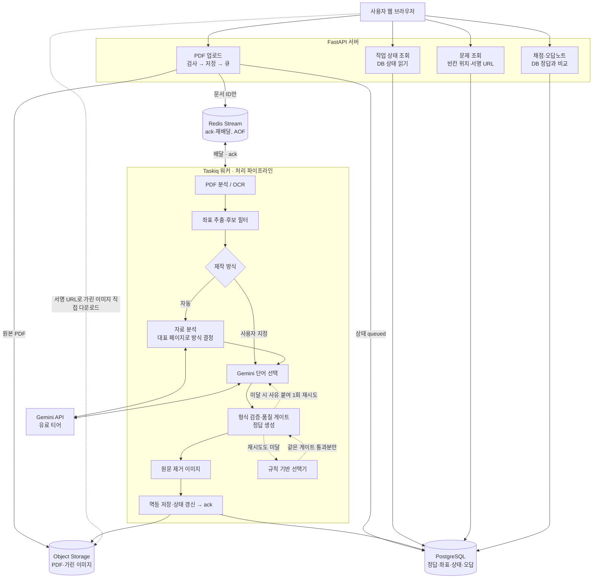

# 아키텍처 정의서 — PDF 빈칸 학습 서비스

- 작성일: 2026-10-27
- 수정: 2026-10-27 제작 방식 선택·자료 분석·품질 게이트 추가(5.3, 5.4), 출처를 공식 문서로 교체
- 상태: **아키텍처 확정(구현 전).** 코드는 아직 없다.
- 관계: `DESIGN.md`(2026-10-02)의 후속 문서. DESIGN.md가 "무엇을, 왜"를 다룬다면 이 문서는 "어떤 부품으로, 어떻게 연결하는가"를 다룬다. 두 문서가 충돌하면 이 문서가 우선한다.
- 결정의 배경·검토한 선택지는 [아키텍처 결정 기록(ADR)](decisions/)에 결정마다 한 파일로 둔다. 이 문서의 결정 표는 요약이다.
- 표기: **[확인]** = 출처로 확인함. **[미확인]** = 구현 전에 확인 필요. **[권장]** = 제안했으나 팀 확정 전.

---

## 1. 한눈에 보기

핵심 구조는 **코드베이스 하나, 프로세스 둘(API + 워커)인 모듈러 모놀리스**다. API는 요청을 빠르게 받고 돌려주는 일만 하고, 수 초~수 분 걸리는 PDF 처리는 전부 워커가 한다.

---

## 2. 확정된 결정

| 항목 | 결정 | 이유 |
|---|---|---|
| 프로세스 구성 | API 서버와 워커를 같은 패키지에서 프로세스만 분리 | PDF 파서 격리(DESIGN D3), 긴 작업이 API를 막지 않게(C22). 이 규모에서 마이크로서비스는 불필요 |
| 작업 큐 | **Taskiq + taskiq-redis `RedisStreamBroker`** | asyncio 기반, ack로 워커가 죽어도 작업이 남음. arq는 유지보수 전용이라 제외 → [ADR-001](decisions/ADR-001-task-queue-taskiq.md) |
| 작업 상태의 기준 | **PostgreSQL** | Redis가 재시작돼도 진행 상태·부분 성공 정보가 남아야 함. Redis는 전달만 담당 |
| 결과 백엔드 | `RedisAsyncResultBackend`는 디버깅용 보조로만, 만료 시간 설정 | 상태 조회 API는 여기를 읽지 않음 |
| 원본 PDF 경로 | 업로드 API가 검사 후 Object Storage에 저장, 큐에는 문서 ID만 | 큐 메시지에 파일을 싣지 않음 |
| 실패 처리 | 검증 실패 → 오류 붙여 1회 재시도 → 규칙 기반 선택기로 폴백 | Gemini 장애에도 서비스가 멈추지 않음(C9, C10) |
| 제작 방식 선택 | 업로드할 때 함께 고른다. 자동(기본)과 프리셋 4종(어휘 문맥, 개념 용어, 수치·날짜, 정의) | 작업 하나·상태 한 벌 구조 유지 → [ADR-004](decisions/ADR-004-preset-at-upload.md) |
| 자료 분석 | "자동"일 때만 파이프라인 안에서 Gemini 1회로 자료 유형을 판단해 방식을 정한다. 분석할 페이지는 시스템이 고른다(5.3) | 사용자는 문서 전체를 올리기만 하면 되고, 페이지를 고르는 부담을 지지 않는다 |
| 품질 게이트 | 형식 검증 뒤에 결정적 코드로 품질의 바닥을 검사한다(5.4). LLM 판정은 바닥에 쓰지 않는다 | 형식만 맞고 쓸모없는 빈칸을 막는다. 실패할 수 있는 검사기에 기대면 바닥이 보장되지 않는다 |
| 흐름 제어 도구 | LangGraph 같은 에이전트 프레임워크는 쓰지 않는다 | 다음 단계를 코드가 정하는 고정 파이프라인 → [ADR-005](decisions/ADR-005-no-agent-framework.md) |
| 후보 필터 | 좌표 추출과 Gemini 호출 사이 | 불용어·머리글/바닥글·저신뢰 OCR 단어 사전 제거(C7) |
| 이미지 전달 | 짧게 만료되는 서명 URL, 가린 이미지만 발급 | API 부하 감소, 원본 이미지 노출 차단(D4) |
| 리댁션 방식 | 렌더링한 이미지에 사각형을 칠하는 래스터 채우기로 통일 | 텍스트 PDF와 스캔본이 같은 경로 → [ADR-003](decisions/ADR-003-raster-redaction.md) |
| PDF 라이브러리 | **pypdfium2(렌더링) + pdfplumber(단어·글자 좌표)** | 라이선스 부담 없음 → [ADR-002](decisions/ADR-002-pdf-library-pdfplumber.md) |
| Gemini 요금제 | 개발 중 무료 티어, 다른 사람 자료를 받기 전에 유료 전환 | 무료 티어 입력은 Google 제품 개선에 쓰이고 사람이 검토할 수 있음 [확인] |
| 배포 | VPS + Docker Compose | 소규모(수십 명 이하)에 가장 단순하고 저렴 |
| 개발 환경 | 파이썬 버전과 라이브러리 버전을 팀 전체가 통일 | 10/27 팀 미팅 결정. 구체 버전은 레포 생성 시 고정 |

### 2.1 권장안 (팀 확정 필요)

| DESIGN.md 항목 | 권장 | 비고 |
|---|---|---|
| 10.1 규모 | (b) 지인·소규모 | 배포 구성(VPS)이 이 전제를 따름 |
| 10.3 인증·비용 | Google 로그인 + 운영자 부담 + 사용자별 일일 한도 | 계정이 있어야 사용자별 캐시·한도·삭제 요청이 성립. BYOK는 후속 옵션 |
| 10.4 자료 성격 | (a) 본인이 올린 자료를 본인만 열람 | 공유 기능은 v2. 접근 제어가 "업로더 본인" 한 줄 규칙으로 끝남 |

---

## 3. 구성 요소

### 3.1 FastAPI 서버
| API | 하는 일 | 읽고 쓰는 곳 |
|---|---|---|
| `POST /documents` | PDF와 제작 방식(`preset`, 기본 `auto`)을 받는다. 크기·MIME 시그니처 검사, 암호화·JS 포함 PDF 거부, 원본을 스토리지에 저장, 상태 `queued` 기록, 작업 등록 | Storage(쓰기), Postgres(쓰기), Redis(작업 등록) |
| `GET /jobs/{id}` | 진행 상태 반환(폴링) | Postgres(읽기) |
| `GET /blank-sets/{id}` | 빈칸 목록(`blank_id`, bbox, type, hint), 가린 이미지의 서명 URL, 적용된 제작 방식과 그 이유(자동일 때). **정답은 포함하지 않음** | Postgres(읽기), 서명 URL 생성 |
| `POST /blank-sets/{id}/attempts` | 전체 답안 일괄 제출 → 칸별 결과·점수, 오답 기록. 시도 횟수 제한 | Postgres(읽기·쓰기) |
| `GET /attempts/{id}/reveal` | 제출 후에만 정답 공개 | Postgres(읽기) |
| `DELETE /documents/{id}` | 업로드·파생물 삭제 | Postgres, Storage |

인증, 사용자별 한도, rate limit은 모든 API 앞단의 공통 의존성으로 둔다.

### 3.2 Taskiq 워커
- 실행: API와 같은 패키지, 별도 컨테이너. 메모리 제한을 건다(PDF 파서 격리, D3).
- 작업 단위: 빈칸 세트 하나(= 문서 하나 + 정책 하나 + 시드).
- 파이프라인 단계는 입력·출력이 명확한 함수로 만들고, 바뀔 수 있는 부분만 어댑터로 뺀다.

| 어댑터 | 현재 구현 | 교체 후보 |
|---|---|---|
| PDF 백엔드 | pypdfium2 + pdfplumber | PyMuPDF(상용 라이선스 또는 AGPL 공개 시) |
| 선택기 | Gemini | 규칙 기반 선택기(폴백 겸용) |
| 렌더러 | strict(서버에서 가린 이미지 생성) | local(개발·디버그 전용, 정답을 클라이언트에 전달) |
| 스토리지 | 로컬 디스크(개발) | S3 호환 서비스(배포) |

이 경계 덕분에 로드맵 0~3단계(박스 뷰어 → 랜덤 가림 → LLM 선택 → 오버레이)는 API·워커 없이 CLI 스크립트로 파이프라인만 돌려 검증하고, 4단계에서 함수들을 워커 작업으로 감싸면 된다.

### 3.3 저장소
| 저장소 | 담는 것 | 비고 |
|---|---|---|
| PostgreSQL | documents, pages, blank_sets(상태, 요청한 방식·적용된 방식, 자료 분석 결과, 페이지별 품질 지표 포함), blanks(정답은 서버 전용), attempts | 상태의 유일한 기준 |
| Object Storage | 원본 PDF, 페이지 원본 이미지, 가린 이미지, 페이지별 토큰 JSON | 원본 이미지에는 서명 URL을 발급하지 않음 |
| Redis | Taskiq Stream(작업 전달), 결과 백엔드(보조) | AOF(`appendonly yes`)로 재시작 시 대기 작업 보존 |

---

## 4. PDF 라이브러리와 좌표

| 라이브러리 | 용도 | 라이선스 |
|---|---|---|
| pypdfium2 | 페이지 → 이미지 렌더링 | Apache-2.0 / BSD-3 [확인] |
| pdfplumber (pdfminer.six 기반) | 단어·글자 좌표, 폰트 정보 | MIT [확인] |
| (제외) PyMuPDF | — | AGPL-3.0 또는 Artifex 상용 라이선스 [확인] |

- pdfplumber 좌표는 **포인트 단위이고 top/bottom이 페이지 위쪽 기준**이다 [확인]. DESIGN.md 7.1의 "원점이 좌하단일 수 있다 [미확인]"은 pdfplumber의 top/bottom 필드를 쓰면 y축 뒤집기가 필요 없다는 것으로 정리된다.
- 저장 좌표는 DESIGN.md C4대로 페이지 기준 0~1, 좌상단 원점.
- 폰트 크기·색은 pdfplumber의 글자 단위 정보(`fontname`, `size`, `non_stroking_color`)에서 가져온다 [확인]. 색 값의 형식(색 공간별 표현)은 pdfplumber `docs/colors.md`를 구현 시 참고.
- OCR 경로(스캔본)는 로드맵 7단계. PaddleOCR 1순위 검토는 그대로.

---

## 5. 작업 처리 흐름

### 5.1 정상 흐름
1. 브라우저가 PDF 업로드.
2. API가 검사 → 원본을 Storage에 저장 → Postgres에 빈칸 세트 상태 `queued` 기록 → 빈칸 세트 ID만 담아 작업 등록 → 작업 ID 반환.
3. 워커가 Stream에서 작업을 받음. Postgres 상태를 `running`으로 갱신.
4. 페이지별로 텍스트 레이어 추출(부족하면 OCR) → 좌표 정규화 → 후보 필터. 제작 방식이 `auto`면 이 시점에 자료 분석(5.3)으로 방식을 정한다.
5. 페이지별로 Gemini 선택 → 형식 검증·품질 게이트(5.4)·정답 생성 → 래스터 채우기로 가린 이미지 생성. 페이지마다 진행률을 Postgres에 기록.
6. 정답·좌표는 Postgres, 이미지는 Storage에 멱등 저장. 상태 `done` 또는 `partial`(일부 페이지 실패, C11).
7. 워커가 ack.
8. 브라우저는 상태 조회 API를 폴링하다가 완료되면 문제 조회 API로 빈칸 목록과 서명 URL을 받고, 이미지는 Storage에서 직접 받는다.
9. 전체 답안 제출 → 채점 API가 Postgres의 정답과 비교 → 결과·오답 기록 → 제출 후에만 정답 공개.

### 5.2 상태 값
`queued` → `running` → `done` / `partial` / `failed`. `failed`일 때는 사용자에게 사유(예: "인식이 잘 안 됐어요, 다시 올려 주세요", C12)를 함께 저장한다. 품질 게이트를 끝내 통과하지 못해 빈칸 없이 내보낸 페이지가 있으면 `partial`로 둔다.

### 5.3 자료 분석 (제작 방식이 `auto`일 때)

| 항목 | 내용 |
|---|---|
| 입력 | 시스템이 고른 대표 페이지의 토큰. 초기 규칙: 텍스트가 충분한 페이지 중 앞 2쪽 + 나머지에서 균등 간격으로 최대 5쪽, 그리고 전체 페이지에서 글자 크기가 가장 큰 줄(제목급)만 추린 목록. 토큰 수 상한을 둔다 [권장, 실측 후 조정] |
| 출력 | 구조화 출력으로 `{doc_type, preset, reason}`. `doc_type`은 정해진 목록(강의 슬라이드, 교재·본문, 논문, 단어장·용어집, 기타) 안에서만 [권장] |
| 실패 | 형식 오류, 목록 밖 값, 타임아웃이면 기본 방식(개념 용어 [권장])으로 진행하고 사유를 기록한다. 예외를 던지지 않는다 |
| 사용자에게 | 결과 화면에 "자동으로 '개념 용어' 방식을 골랐어요(이유: …)"를 보여 준다. 마음에 들지 않으면 다른 방식을 지정해 새 빈칸 세트를 만든다 |
| 비용 | 문서당 Gemini 1회 추가 |

### 5.4 품질 게이트

원칙: **품질의 바닥은 결정적 코드로만 판정한다.** 같은 입력이면 같은 판정이 나오고, LLM을 부르지 않는다. 코드가 재는 것은 품질 자체가 아니라 품질의 대리 지표이므로, 기준값은 실데이터로 보정한 뒤 확정한다.

**칸 단위** (미달인 칸만 제거)

| 검사 | 초기 기준(가설) | 막는 실패 |
|---|---|---|
| 정답 노출 | 같은 페이지의 가려지지 않은 곳에 같은 단어가 있으면 제거하거나 `answer_group`으로 함께 가린다. 한국어는 조사를 떼고 비교 | 다른 줄을 보고 베끼기 |
| 토큰 정상성 | 하이픈으로 끝나는 토큰, 숫자·기호가 섞인 토큰, OCR 저신뢰 토큰 제거 | 줄바꿈으로 잘린 반쪽 단어가 정답이 됨 |
| 길이 | 영어 3자 미만·25자 초과, 한국어 2자 미만 제거 | 운으로 맞힘, 칸이 넘침 |

**페이지 단위**

| 검사 | 초기 기준(가설) | 막는 실패 |
|---|---|---|
| 생존 개수 | 칸 단위 검사를 통과한 수 ÷ 목표 개수(C8) < 60%면 미달 | LLM이 엉뚱한 단어를 골라 대부분 탈락 |

**미달일 때 경로:** 형식 검증 실패와 같은 경로를 쓴다. Gemini 시도는 첫 시도와 재시도 1회를 형식·품질이 공유한다(재시도 때 오류·탈락 사유를 붙인다). 그래도 미달이면 규칙 기반 선택기를 쓰고, 그 결과도 같은 게이트를 통과해야 한다. 그마저 미달이면 그 페이지는 빈칸 없이 내보낸다. 어느 경우에도 예외를 던지지 않는다(6.1).

**후보 지표 (보정 후 추가 검토):** 일반어 비율, 문서 핵심어 겹침, 세로 분포, 중복률. 일반어·핵심어 지표는 언어별 단어 빈도표(외부 자료)가 필요하다. 게이트를 늘릴수록 폴백 비율이 오르므로 처음에는 위 4개로 시작한다.

**기준값 보정 (로드맵 2단계 완료 조건):**
1. 실제 수업 PDF 5~10개에서 Gemini 결과와 규칙 기반 결과를 뽑는다.
2. 2명 이상이 칸마다 좋음 / 애매 / 나쁨을 붙인다.
3. 지표별로 좋음 칸과 나쁨 칸의 값 분포를 비교한다.
4. 기준값 후보마다 "나쁜 칸을 걸러낸 비율 / 좋은 칸을 잘못 버린 비율"을 구해 정한다. 둘이 잘 갈리지 않는 지표는 버린다.
5. Gemini와 규칙 기반 결과는 같은 PDF, 같은 라벨러, 같은 기준으로 비교한다.

**운영 지표 (게이트가 아니라 경보용):** 폴백 페이지 비율, 칸 탈락률, 사용자 정답률 분포, "이 빈칸 이상해요" 신고율. 페이지별 지표·시도 횟수·선택 출처(`gemini` / `fallback`)를 blank_sets에 기록한다. 폴백 비율이 평소보다 크게 뛰면 경보를 보낸다. 프롬프트나 모델을 바꿀 때는 기준 PDF 세트로 지표를 다시 재서 이전 값과 비교한다.

---

## 6. 신뢰성 설계 (Taskiq)

### 6.1 실패 종류별 담당

| 상황 | 담당 | 동작 |
|---|---|---|
| 워커가 처리 중 죽음(배포, 메모리 초과) | RedisStreamBroker의 ack·재배달 | ack가 없으면 `idle_timeout` 후 다른 워커가 넘겨받아 재실행 [확인] |
| Gemini 일시 오류, 네트워크 끊김 | `SimpleRetryMiddleware` | 작업이 예외를 던지면 같은 인자로 다시 보냄. `retry_on_error=True` 라벨이 붙은 작업에만 적용 [확인]. 최대 2회 |
| Gemini 응답이 검증 실패 | 파이프라인 내부 | 오류를 붙여 1회 재시도 → 규칙 기반 폴백. **예외를 던지지 않는다**(던지면 미들웨어가 작업 전체를 다시 돌려 Gemini 비용이 두 배) |
| OCR 인식 실패, 잘못된 파일 | 파이프라인 내부 | 상태 `failed` + 사유 기록. 재시도할 의미가 없으므로 예외를 던지지 않음 |
| 자료 분석 실패 | 파이프라인 내부 | 기본 방식으로 진행하고 사유 기록(5.3). 예외를 던지지 않음 |
| 품질 게이트 미달 | 파이프라인 내부 | 형식 검증 실패와 같은 경로(5.4). 예외를 던지지 않음 |
| Redis 재시작 | Redis AOF | 대기 중 작업 보존 |

정리하면 **작업이 예외를 던지는 경우는 "다시 하면 될 수도 있는" 일시적 오류뿐**이다.

참고: `SimpleRetryMiddleware`는 "Redis가 죽었을 때 재시도"가 아니라 "작업 실행 중 예외가 났을 때 재시도"다. 워커·Redis 장애 대응은 위 표의 Stream ack와 AOF가 맡는다.

### 6.2 시간 설정 (초기값)

| 설정 | 초기값 | 근거 |
|---|---|---|
| 업로드당 페이지 상한 | 30쪽 | DESIGN D1 |
| 작업 제한 시간 (Taskiq `timeout` 라벨) | 8분 | 30쪽 처리 시간을 측정한 뒤 조정 |
| `idle_timeout` (RedisStreamBroker) | 15분 | 기본값은 `600000`(밀리초, 10분). 이 시간 동안 ack가 없으면 `XAUTOCLAIM`으로 다른 워커가 넘겨받는다 [확인] |
| Gemini 호출당 타임아웃 | 측정 후 결정 | R4 |

**규칙: 작업 제한 시간 < `idle_timeout`.** `idle_timeout`이 지나면 워커가 살아서 아직 처리 중이어도 작업이 다른 워커에 다시 넘어가 두 번 실행된다(장시간 작업에서 실제로 보고된 사례) [확인]. 30쪽 처리가 8분을 넘는 것으로 측정되면 작업을 페이지 묶음 단위로 쪼갠다.

### 6.3 멱등성
Stream 방식은 "최소 한 번 실행"이므로 같은 작업이 두 번 돌 수 있다. 두 번 돌아도 결과가 같게 만든다.

1. 작업 시작 시 Postgres에서 빈칸 세트 상태를 확인하고, 이미 `done`이면 바로 종료(ack).
2. 빈칸·정답 저장은 빈칸 세트 ID 기준 upsert(또는 삭제 후 삽입을 한 트랜잭션으로).
3. 이미지 키를 `blank_sets/{세트 ID}/page_{번호}.png`처럼 고정해서 덮어써도 무해하게.
4. 모든 저장이 끝난 뒤에 상태를 `done`으로 바꾸고, 그다음 ack.

중복 실행 시 남는 손해는 Gemini 호출 비용뿐이고, 드문 경우라 감수한다.

### 6.4 결과 백엔드
`RedisAsyncResultBackend`는 디버깅용으로만 쓰고 결과 만료 시간을 설정해 Redis에 결과가 계속 쌓이지 않게 한다(설정 파라미터 이름은 구현 시 확인 [미확인]). 상태 조회 API는 결과 백엔드를 읽지 않는다.

---

## 7. 배포 구성 (Docker Compose)

| 서비스 | 역할 | 메모 |
|---|---|---|
| `caddy` | HTTPS, 리버스 프록시, 정적 파일 | 인증서 자동 갱신 |
| `api` | FastAPI | 무상태. CORS는 허용 도메인 목록으로 제한(R3) |
| `worker` | Taskiq 워커 | 메모리 제한, 파서 격리 |
| `redis` | Stream 브로커 | AOF 켬 |
| `postgres` | DB | 정기 백업 |
| 스토리지 | 개발: 로컬 볼륨 / 배포: S3 호환 서비스 | 어댑터로 교체 |

비밀값(API 키, DB 비밀번호)은 환경 변수로 주입하고 레포에는 예시 파일만 둔다(D8, D10).

---

## 8. 이번 정리로 해소된 DESIGN.md 미확인 항목

| 항목 | 결과 |
|---|---|
| PyMuPDF 라이선스 | AGPL-3.0 또는 상용 [확인] → 사용하지 않음 |
| pypdfium2·pdfplumber·pdfminer.six 라이선스 | Apache-2.0/BSD-3, MIT, MIT [확인] |
| pdfplumber 좌표 원점 | 포인트 단위, top/bottom은 페이지 위쪽 기준 [확인] |
| pdfplumber 폰트 크기·색 필드 | `fontname`, `size`, `non_stroking_color`, `stroking_color` [확인] |
| Gemini 무료 티어 데이터 정책 | 무료 티어 입력은 제품 개선에 사용·사람 검토 가능, 유료는 사용 안 함. 결제 계정 연결 시 모든 사용량 과금 [확인] |

## 9. 남은 확인 사항

| 항목 | 상태 |
|---|---|
| 10.1 / 10.3 / 10.4 권장안 팀 확정 | 미결정(2.1) |
| 파이썬·라이브러리 구체 버전 | 레포 생성 시 고정 |
| 품질 게이트 기준값 | 로드맵 2단계에서 실데이터로 보정(5.4) |
| 자료 분석용 대표 페이지 규칙·토큰 상한 | 실제 자료로 측정 후 조정(5.3) |
| `doc_type` 목록, 자동 실패 시 기본 방식 | [권장], 팀 확정 필요 |
| 한국어 단어 빈도표 출처·라이선스 | [미확인], 후보 지표를 추가할 때 확인 |
| `RedisAsyncResultBackend` 만료 설정 방법 | [미확인] |
| 30쪽 처리 시간 실측 → 작업 제한 시간·`idle_timeout` 조정 | 로드맵 5단계에서 측정 |
| Tesseract·PaddleOCR 라이선스 | [미확인], 7단계 전 확인 |

## 10. 다음 행동

1. 2.1의 권장안 3건을 팀에서 확정한다.
2. 공용 레포 생성, 파이썬·라이브러리 버전 고정.
3. 모듈별 역할 분담: PDF 처리·좌표 추출 / LLM 선택·검증 / 프론트 오버레이·채점 화면 / 서버·DB·워커·개발 환경.
4. 로드맵 0단계(박스 뷰어)부터 CLI로 구현.
5. 로드맵 2단계를 마칠 때 품질 게이트 기준값을 보정한다(5.4). 라벨 작업에 2명 이상 참여.

---

## 11. 출처

- PyMuPDF 라이선스: https://pypi.org/project/PyMuPDF/1.19.0/
- pypdfium2 라이선스: https://pypi.org/project/pypdfium2/
- pdfplumber 좌표 규약·글자 필드: https://github.com/jsvine/pdfplumber/blob/stable/README.md
- pdfplumber 라이선스(MIT): https://github.com/jsvine/pdfplumber/blob/stable/LICENSE.txt
- Gemini API 약관(무료/유료 데이터 사용): https://simonwillison.net/2024/Oct/17/gemini-terms-of-service
- Gemini 결제 연결 후 과금: https://discuss.ai.google.dev/t/clarification-on-gemini-api-free-tier-vs-paid-tier-after-billing-activation/96995
- arq 유지보수 전용 모드: https://github.com/python-arq/arq
- Taskiq 미들웨어(SimpleRetryMiddleware): https://taskiq-python.github.io/available-components/middlewares.html
- RedisStreamBroker 파라미터(`idle_timeout` 기본값, `XAUTOCLAIM`): https://github.com/taskiq-python/taskiq-redis/blob/master/taskiq_redis/redis_broker.py
- RedisStreamBroker 장시간 작업 재배달 이슈: https://github.com/taskiq-python/taskiq-redis/issues/101
